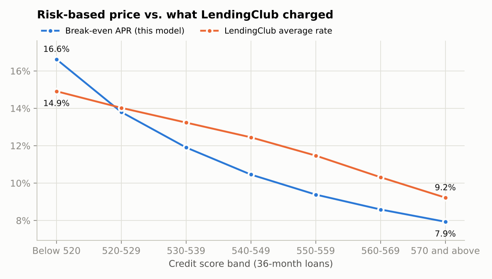
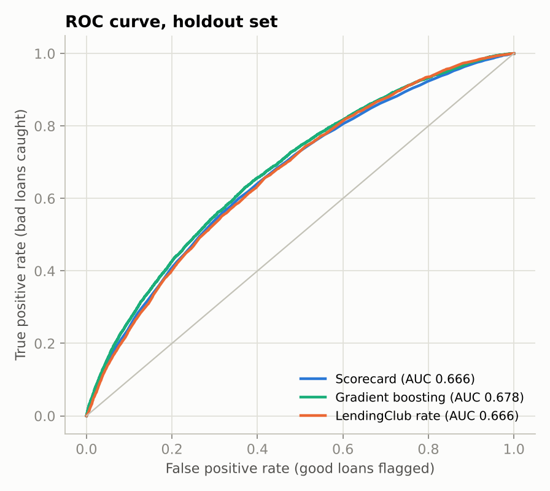
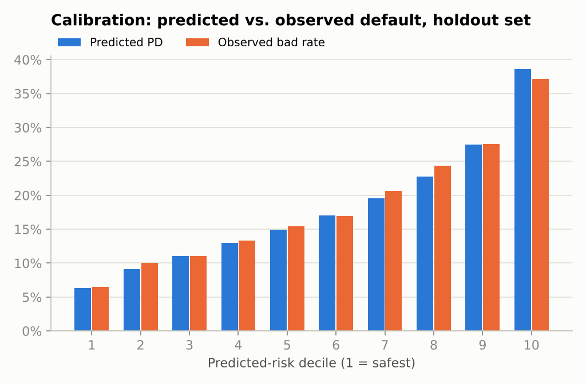
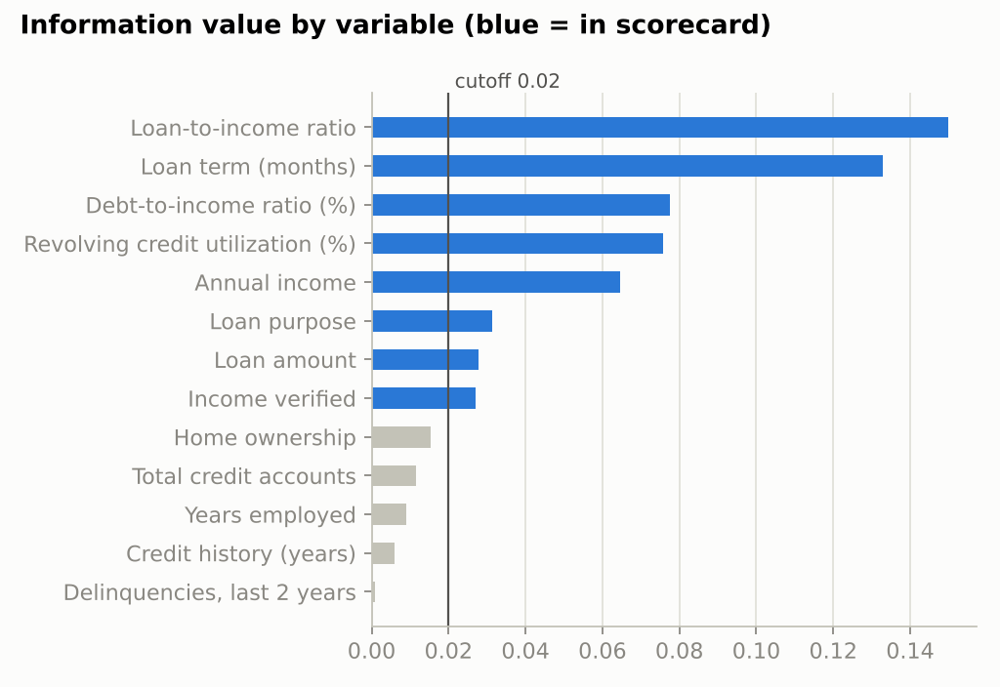

# Credit Risk Scorecard & Loan Pricing Model

Predicts the probability that a consumer borrower defaults, using **163,958 real LendingClub loans**, then prices each loan so the lender earns its required return after expected losses. The model is built and validated in Python, and the pricing tool is an **Excel workbook driven entirely by live formulas**: enter an application and get a credit score, default probability, expected loss, a risk-based APR and an approve/decline decision.

**Files**
- `excel/Credit_Risk_Pricing_Model.xlsx`: the scorecard and pricing tool. Start on the *Pricing Tool* sheet.
- `run_model.py`: fits and validates the scorecard and exports it to `outputs/model.json`.
- `build_workbook.py`: writes the Excel workbook from the fitted model.

## How it works

```
Loan data ──► WoE binning ──► Logistic regression ──► Points scorecard ──► PD
                                                                            │
                LGD (90%, published research) ─────────────────────────────►├──► Expected loss = PD × LGD × EAD
                EAD (from the amortization schedule) ──────────────────────►│
                                                                            ▼
                         Lender's required return, servicing cost ──► Break-even APR + margin ──► Offer / decline
```

1. **Screen variables.** Each of 13 borrower characteristics is binned so the default rate moves in one direction across its bins, then scored by information value (IV). The 8 variables with IV ≥ 0.02 are kept.
2. **Fit a scorecard.** A logistic regression on weight-of-evidence (WoE) values is converted to points: 600 points = 50:1 odds of repayment, and every 20 points doubles the odds. Points scorecards are the industry standard for consumer credit because every decision can be explained band by band.
3. **Estimate expected loss.**
   - PD comes from the score.
   - LGD is 90%, based on Gallo (2021), *Financial Innovation*, which found a mean LGD of 90.2% across 291,664 defaulted LendingClub loans.
   - EAD is the expected balance at default from the amortization schedule.
4. **Price the loan.** Expected monthly cash flows are survival-weighted payments net of a 1% servicing fee, plus recoveries six months after any default. The break-even APR sets the loan's expected NPV to zero at a 6% required return. Expected NPV has a closed form, so Excel finds the break-even rate by bisection without macros or Goal Seek.

LendingClub's own interest rate was held out of the model, because a pricing model can't use the price as an input. It's used only as a benchmark.

## Results

**Discrimination on the 49,188-loan holdout set**

| Model | AUC | Gini | KS |
|---|---:|---:|---:|
| Scorecard (8 variables, points-based) | 0.666 | 0.332 | 0.244 |
| Gradient boosting, same 13 variables | 0.678 | 0.356 | 0.260 |
| LendingClub's own interest rate | 0.666 | 0.333 | 0.240 |
| Gradient boosting + LendingClub's rate | 0.702 | 0.404 | 0.293 |

- **The scorecard ranks risk as well as LendingClub's own pricing grade**, without a FICO score or the interest rate.
- A black-box gradient-boosting model adds only 0.012 AUC, so the transparent scorecard gives up very little.
- **It is well calibrated.** Predicted and observed default rates agree within 1.5 percentage points in every risk decile. The score distribution is stable between training and holdout (PSI 0.0003).

**Pricing vs. what LendingClub actually charged** (36-month loans, 6% required return)

| Score band | Loans | Bad rate | Break-even APR | LendingClub avg. rate | Expected NPV per $10K at LendingClub's rate |
|---|---:|---:|---:|---:|---:|
| Below 520 | 10,876 | 30.3% | 16.6% | 14.9% | −$236 |
| 520–529 | 22,728 | 21.9% | 13.8% | 14.0% | $31 |
| 530–539 | 31,662 | 16.5% | 11.9% | 13.2% | $191 |
| 540–549 | 30,335 | 12.3% | 10.5% | 12.4% | $290 |
| 550–559 | 20,705 | 9.2% | 9.4% | 11.5% | $306 |
| 560–569 | 9,473 | 6.8% | 8.6% | 10.3% | $255 |
| 570 and above | 4,142 | 4.8% | 7.9% | 9.2% | $191 |

**LendingClub's price curve was flatter than the risk curve.**
- Its rates rose 5.7 percentage points from the safest band to the riskiest, while the break-even rate rises 8.7 points.
- The riskiest band was priced below break-even, an expected loss of $236 per $10,000 lent.
- Safer bands carried a cushion of 1.3–2.1 points, so they effectively subsidized the riskiest one.
- Caveat: LendingClub's pricing also used FICO scores, which this data doesn't include.



<p float="left">
  
  
</p>



## The Excel workbook

| Sheet | What it does |
|---|---|
| Pricing Tool | Application inputs, score build-up, PD / LGD / EAD / expected loss, decision, offered APR and price build-up |
| Assumptions | Required return, servicing fee, LGD, recovery lag, margin, rate cap, PD limit, scorecard scaling, each with its source |
| Scorecard | Points for each variable band, calculated by formula from the fitted WoE values and coefficients |
| Cash Flows | Month-by-month expected cash flows, NPV and loss-adjusted IRR; independently checks the Solver |
| Solver | Closed-form expected NPV and a 30-step bisection for the break-even APR, for the applicant and every score band |
| Risk-Based Pricing | Break-even APR by band vs. LendingClub's actual rate, with a chart |
| Model Performance | AUC, KS, calibration table and chart, IV screening, regression output |

**Example applicant:** $12,000 over 36 months, $65,000 income, 18% DTI, 45% revolving utilization, debt consolidation.

| Output | Value |
|---|---|
| Score | 540 |
| Lifetime PD | 13.8% |
| Expected loss | $828 (6.9% of the loan) |
| Break-even APR | 11.03% |
| Price build-up | 5.84% required return + 0.68% servicing + 4.52% credit risk premium |
| Offered APR | 12.03% (break-even + 1.00% margin) |
| Decision | Approve |
| Expected return after losses | 7.05% |

Formatting follows banking conventions:
- Blue text = inputs and historical data
- Black text = formulas
- Green text = links to other sheets
- Yellow cells = what you're meant to change

## Validation

- `pytest -q` runs 15 unit tests:
  - the closed-form NPV matches a month-by-month cash-flow schedule
  - the break-even rate gives zero NPV and rises with risk
  - a riskless, fee-free loan breaks even exactly at the required return
  - the score-to-PD scaling is correct
  - binning produces monotonic bad rates
- `python tests/verify_workbook.py <path to recalc.py>` writes five test applications into the workbook, recalculates it in LibreOffice, and confirms Excel's score, PD, break-even APR and decision match Python exactly. Two of the five are declines.

## Run it

```bash
pip install -r requirements.txt
python run_model.py        # fit, validate, figures, outputs/model.json (~20 s)
python build_workbook.py   # excel/Credit_Risk_Pricing_Model.xlsx
pytest -q
```

Open the workbook in Excel and it recalculates on load.

## Data

LendingClub's public loan history of completed loans, as packaged by H2O.ai for its consumer-loan demo: [`data/loan.csv`](https://github.com/h2oai/app-consumer-loan). `bad_loan` = 1 if the loan was charged off or defaulted. The 70/30 train/holdout split is random and stratified, because the file has no issue dates.

## Limitations

- **No credit bureau score (FICO)** in the data. That caps how well any model can rank risk here; real lenders reach AUCs of 0.75 or more with bureau data.
- **Constant monthly default hazard.** Real defaults cluster in the first one to two years, so this slightly understates exposure at default.
- **No prepayment.** Early payoffs shorten the loan and lower interest income.
- **LGD is a single published average.** It isn't modeled by loan type, because the data has no recovery amounts.
- **No out-of-time test.** A production model would be validated on later loans, not a random holdout.
